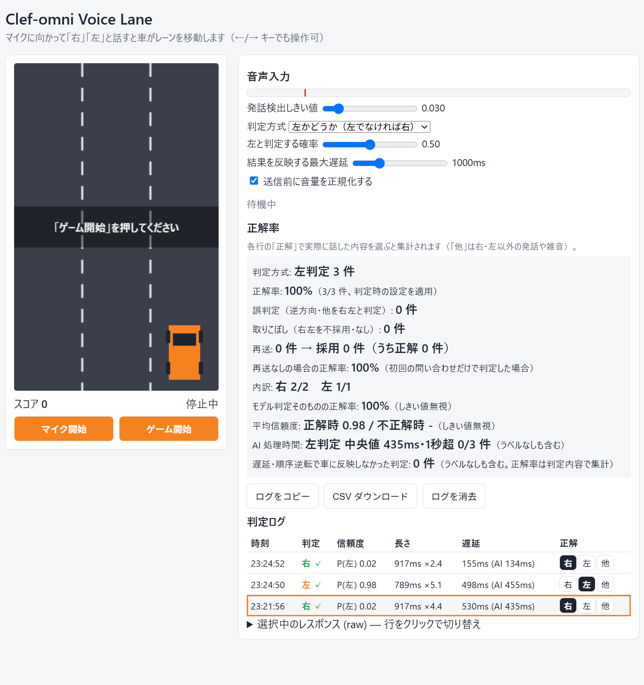

# Clef-omni Voice Lane

[Clef-omni](https://developers.cloudflare.com/workers-ai/models/clef-omni/)（`@cf/cloudflare/clef-omni`）の音声入力を検証するための簡易アプリです。
マイクで日本語の「右」「左」を話すと Clef-omni が方向を判定し、3 レーンを走る車が左右に移動します。



検証の経過と結果は [docs/evaluation-report.md](docs/evaluation-report.md) にまとめています。

## 構成

```
public/
  index.html            画面
  app.js                マイク入力・発話区間検出(VAD)・API 呼び出し・判定ログと正解率集計・ゲーム
  audio.js              ダウンサンプリング / 音量正規化 / WAV エンコード / base64 化
  recorder-worklet.js   マイク音声を約 20ms 単位で取り出す AudioWorklet
  style.css
src/index.js            Worker（静的ファイル配信 + POST /api/direction）
wrangler.jsonc          Workers AI バインディング(AI)と静的アセットの設定
```

## 処理の流れ

1. ブラウザでマイク音声を取得し、音量しきい値で 1 発話を切り出す（発話前 250ms を含め、無音 350ms で終了、最大 1.5 秒）
2. 16kHz / 16bit / モノラルの WAV に変換し（オプションで音量を正規化）、base64 data URL で `POST /api/direction` に送信
3. Worker が Clef-omni に問い合わせる（判定方式は画面で切り替え）
   - **左かどうか（既定）**: `noul` 型の質問で「左と言ったか」の確率 `P(左)` を求め、「左と判定する確率」以上なら左、そうでなければ右
   - **3 択**: `choice` 型の質問（`right` / `left` / `none`）で判定し、信頼度が「判定の最低信頼度」以上なら採用
4. 判定結果に従って車を移動

Worker から Clef-omni へのリクエストは次の形です（判定に不要な文脈は入れず、`state` は最小限）。

```js
await env.AI.run("@cf/cloudflare/clef-omni", {
  model: "clef-omni",
  state: "A short Japanese voice command.",
  audio: ["data:audio/wav;base64,..."],
  questions: {
    direction: {
      type: "noul",
      instructions:
        "Did the speaker say 「左」/「ひだり」 (hidari, left), possibly with 左へ or 左に? " +
        "Answer no for any other word, including 「右」/「みぎ」 (migi, right).",
    },
  },
});
```

## 実行方法

Cloudflare アカウントで Workers AI が利用可能である必要があります。

```sh
npm install
npx wrangler login
npm run dev      # http://localhost:8787 （AI バインディングは常にリモートの Workers AI を使用し、課金対象）
npm run deploy   # workers.dev にデプロイ
```

マイクは安全なコンテキストでのみ使用できるため、`localhost` か HTTPS（workers.dev 等）でアクセスしてください。

## 使い方

1. 「マイク開始」を押してマイクを許可
2. 何も話していない状態でメーターが赤線（発話検出しきい値）より下になるよう、しきい値を調整
3. 「ゲーム開始」を押し、「右」「左」と話して落ちてくる障害物を避ける
   （←/→ キーでも操作できるため、音声判定と比較しながら検証できます）

判定ログには、判定結果・信頼度・送信した発話の長さ（音量を正規化した場合は増幅率 `×n`）・往復遅延（括弧内は Worker で計測した Clef-omni の処理時間）・
入力トークン数と Neurons（レスポンスの `usage.input_tokens` から 100 万トークンあたり 13,636 Neurons で換算。再送分を含む）が表示されます。
正解率欄には、ログ全体の累計トークン数・Neurons・推定料金も表示されます。
行をクリックすると、その判定の Clef-omni の回答オブジェクトを「選択中のレスポンス (raw)」で確認できます。

## 精度の検証

1. 「右」「左」と話したあと、判定ログの各行の「正解」で実際に話した内容（右 / 左 / 他）を選ぶ
   - 「他」は右・左以外の発話や雑音。これらが右・左として採用されなかった場合を正解とする
2. 「正解率」欄に次の集計が表示される
   - 正解率（判定した時点の最低信頼度を適用した、ゲームに反映された結果ベース）
   - 誤判定（逆方向や「他」を右・左と判定した件数）と取りこぼし（右・左を不採用・なしにした件数）
   - 正解ラベルごとの内訳
   - モデル判定そのものの正解率と、正解時 / 不正解時の平均信頼度（しきい値を無視。最低信頼度の調整に使う）
3. 「ログをコピー」で集計と全判定（タブ区切り）をクリップボードへ、「CSV ダウンロード」で CSV ファイルとして保存できる

## 判定方式

3 択で検証したところ、「左」はほぼ確実に判定できる一方、「右（みぎ）」は聞き取れず「なし」になることが多かったため、
「左かどうか」だけを判定し、左でなければ右とする方式を既定にしています。
この方式は常に右か左に決まるため、雑音や右・左以外の発話も「右」として扱われます（発話区間の検出で拾った音だけが対象）。
判定ログの信頼度欄には `P(左)` を表示します。

同じ「左かどうか」を `choice` 型（左 / それ以外の 2 択）で尋ねる方式とも比較しました。AI 処理時間は同等（中央値 約 160ms）でしたが、
右と話したときの `P(左)` が `noul` 型は 0.01〜0.06、`choice` 型は最大 0.34 と、`noul` 型のほうがしきい値に対する余裕が大きかったため、`noul` 型を採用しています。

## 遅延対策

Workers AI の処理時間は時間帯によってばらつき、1 秒を超えることがあります（最大 3.7 秒を観測）。遅れて車が動くと操作として不自然なため、次のようにしています。

- 発話の送信から「結果を反映する最大遅延」（既定 1000ms）を超えて返ってきた判定は、車に反映しない
- 後の発話の結果を先に反映した場合、それより前の発話の結果は反映しない（応答の順序が逆転したとき）
- 5 秒以内に応答がない問い合わせはタイムアウトとして打ち切る

反映しなかった判定もログ・正解率の集計には残り、判定欄に理由が表示されます。正解率欄の「AI 処理時間」で判定方式ごとの中央値と 1 秒超の件数を確認できます。

## 信頼度不足時の再送（3 択のみ）

Clef-omni は音声を約 13 トークン/秒（1 トークン ≒ 77ms）に変換するため、「みぎ」のような短い単語は数トークンにしかならず、
単語がトークン境界のどこに来るかで判定が不安定になる可能性があります。

「信頼度不足のときの再送」を有効にすると、初回の信頼度が「判定の最低信頼度」未満だった場合に、
音声の先頭に 38ms / 19ms / 58ms（約 1/2・1/4・3/4 トークン）の無音を足したものを設定回数ぶん並列に再送し、
採用できる結果のうち最も信頼度の高いものを使います（既定は 2 回）。追加の料金と遅延（約 1 往復分）は再送時のみ発生します。

正解率欄の「再送」「再送なしの場合の正解率」で、再送で拾えた件数と効果を確認できます。
コピー / CSV には初回の結果（`first_*`）と全試行（`attempts_json`）も含まれます。

「送信前に音量を正規化する」を有効にすると、発話区間のピーク音量が 0.9 になるよう増幅してから送信します（最大 10 倍、減衰はしない）。
オン / オフを切り替えて正解率を比べることで、正規化の効果を確認できます。

## 注意事項

- `choice` 回答のうち本アプリが使うのは `choice` と `confidence` です。選択肢ごとの確率は `probabilities` として転送していますが、
  フィールド名はドキュメントで明示されていないため、実際の値は raw 表示で確認してください。
- 1 発話あたりの音声は Worker 側で 1 MiB までに制限しています（Clef-omni 自体の上限は 1 クリップ 8 MiB / 300 秒）。
- 料金は入力トークン課金（$0.15 / 100 万トークン）です。音声はトークンに換算されて課金されます。
